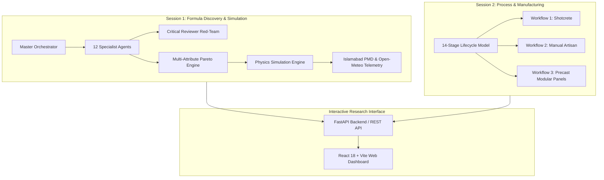

# Sabzaar Living Walls Research Laboratory 🌿🔬
### Multi-Agent Autonomous Material Science & Environmental Simulation Platform

**Sabzaar** is an intelligent, multi-agent computational laboratory designed to discover, formulate, optimize, and simulate bioreceptive living wall systems for arid and subtropical urban climates, benchmarked for **Islamabad, Pakistan** (PMD Station 415710).

---

## 🏗️ System Architecture

The laboratory is structured into two research sessions:
- **Session 1 — Formula Discovery & Environmental Simulation:**
  - 12 Autonomous Specialist Agents + 1 Phase 2 Critical Reviewer red-teaming engine.
  - Multi-objective Pareto optimization across 10 performance criteria.
  - 48h/72h physics-based hourly environmental simulation engine (Penman-Monteith evaporation, Richard's unsaturated moisture transport, and thermal kinetics).
- **Session 2 — Process Discovery & Manufacturing Engineering:**
  - 14-stage industrial manufacturing pipeline evaluation.
  - 3 alternative deployment workflows: Mechanized Pneumatic Shotcrete, Low-Tech Manual Plastering, and Off-Site Modular Precast Panels.



---

## 🧪 Four Formulation Categories

| Category | Formulation Name | Matrix Concept | Layer 1 Cost (BOM) | Total Material BOM | Compressive Strength (28d) |
| :--- | :--- | :--- | :---: | :---: | :---: |
| **Formula A** | Original HTML Baseline | 40% OPC + 20% Sand + 40% Pumice | PKR 426.00 / m² | PKR 816.00 / m² | 24.50 MPa |
| **Formula B** | Ideal Performance Matrix | Dead-Burned MgO + MKP Buffer | PKR 826.17 / m² | PKR 1,306.17 / m² | 32.10 MPa |
| **Formula C** | Circular Recyclable Matrix | GGBS (16%) + RHA (10%) + Brick (24%) + Marble (14%) | **PKR 119.67 / m²** | **PKR 360.87 / m²** | **21.51 MPa** |
| **Formula D** | Indigenous Mineral Cost-Min | Hydrated Lime + Surkhi + Bentonite | PKR 131.04 / m² | **PKR 195.04 / m²** | 14.98 MPa |
| **Champion** | **Sabzaar Hybrid Champion** | **11-Ingredient Eco-Performance Matrix** | **PKR 268.00 / m²** | **PKR 383.00 / m²** | **27.26 MPa** |

### Recommended Champion Formula (100.00% Mass Balance)
- **Layer 1 Matrix (100 kg dry batch):**
  - Ordinary Portland Cement: 14.0% (14.0 kg)
  - Rice Husk Ash (RHA): 14.0% (14.0 kg)
  - Ground Granulated Blast-Furnace Slag (GGBS): 8.0% (8.0 kg)
  - Crushed Clay Brick (1–3 mm): 20.0% (20.0 kg)
  - Graded Silica River Sand (0.3–1.2 mm): 28.0% (28.0 kg)
  - Waste Marble Powder (<75 µm): 12.0% (12.0 kg)
  - Microfibrillated Cellulose (MFC): 1.5% (1.5 kg)
  - Bone Ash: 1.0% (1.0 kg)
  - Polypropylene Fibres (6 mm): 0.5% (0.5 kg)
  - Chopped Jute Fibres (10 mm): 0.5% (0.5 kg)
  - Hydroxypropyl Methylcellulose (HPMC): 0.5% (0.5 kg)
  - **Total Dry Mass:** **100.00% (100.00 kg)**
- **Layer 2 Bio-Gel Living Coat (Per 1.0 L Soft Water):**
  - Sodium Alginate: 18.0 g/L (Thixotropic shear-thinning binder)
  - Psyllium Husk: 12.0 g/L (Secondary swelling hydro-matrix)
  - Potassium Citrate Buffer: 4.5 g/L (Acid neutralizer & micro-nutrient)
  - Hoagland Nutrient Salts: 2.2 g/L (Macronutrients)
  - Micronized Chlorella Extract: 3.0 g/L (Bio-stimulant)
  - Dry Moss Fragments (*Funaria hygrometrica* & *Barbula unguiculata*): 45.0 g/L

---

## ⚡ Quick Start

### 1. Prerequisites
- Python 3.11+
- Node.js 18+ and npm
- (Optional) Google Gemini API Key

### 2. Backend Setup
```bash
# Clone the repository
git clone <YOUR_GITHUB_REPO_URL>
cd Orchestrator

# Create virtual environment & install dependencies
python -m venv .venv
source .venv/bin/activate  # On Windows: .venv\Scripts\activate
pip install -r requirements.txt

# Configure environment
cp .env.example .env
# Edit .env with your optional GEMINI_API_KEY

# Run FastAPI server
python -m uvicorn backend.app.main:app --host 127.0.0.1 --port 8000 --reload
```

### 3. Frontend Setup
```bash
cd frontend
npm install
npm run dev
# Or build for production:
npm run build
```

The production frontend bundle is automatically served by FastAPI at `http://127.0.0.1:8000/`.

---

## 🧪 Scientific Validation & Automated Test Suite

Run the full automated test suite verifying all 11 scientific gates:
```bash
pytest backend/tests/test_backend.py -v
```

All 11 tests pass with 100% compliance:
- `test_health`: API and database status.
- `test_formulas`: Integrity of all 4 formula categories.
- `test_baseline_immutability`: Guaranteed immutability of original HTML formula.
- `test_mass_balance_validator`: Strict 100.00% mass balance enforcement.
- `test_simulation_run`: 48h/72h Penman-Monteith moisture & evaporation simulation.
- `test_weather_endpoints`: Islamabad PMD Station 415710 weather and provenance.
- `test_gemini_honest_status`: Zero simulated or fake AI heuristics.
- `test_process_comparison`: 14-stage manufacturing lifecycle comparison.
- `test_agents_and_reviewer`: Live agent execution and red-team review.
- `test_score_audit`: Mathematical derivation, weights, and uncertainty metrics.
- `test_final_deliverable`: 100.00% mass balance verification in deliverable reports.

---

## 📄 License
MIT License. Developed for advanced ecological engineering and sustainable urban cooling.
